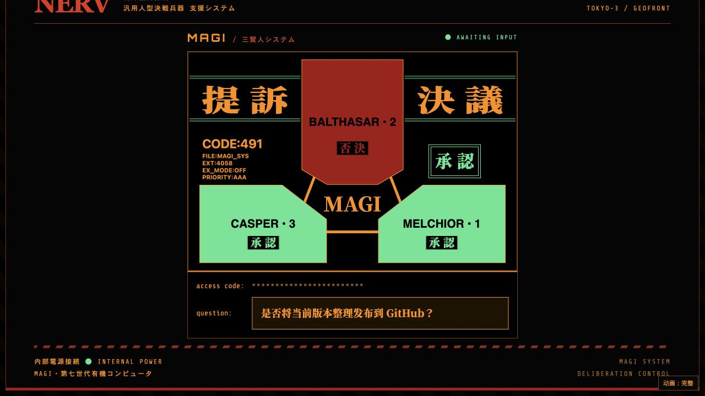

# MAGI × Qoder Cloud Agents

*An Evangelion-inspired three-unit AI deliberation console.*

EVA《新世纪福音战士》MAGI 系统的非官方同人项目。基于 [hirakujira/MAGI-System](https://github.com/hirakujira/MAGI-System)，保留 NERV 控制台、三主机布局、开机与入场动画、粒子传输和入侵彩蛋，将审议后端接入 Qoder Cloud Agents。

仓库：[guy050128/magi-qoder](https://github.com/guy050128/magi-qoder) · 运行细节：[RUN.md](RUN.md) · 来源与许可：[THIRD_PARTY_NOTICES.md](THIRD_PARTY_NOTICES.md)



离线 mock 模式截图；票型为模拟数据，不代表真实模型输出或响应速度。

## 审议方式

| 主机 | 视角 |
| --- | --- |
| MELCHIOR • 1 | 科学家：逻辑与理性分析 |
| BALTHASAR • 2 | 母亲：保护与关怀 |
| CASPER • 3 | 女性：直觉与情感洞察 |

三台主机接收同一个完整议题，人格提示词保存在各自 Agent 的 `system` 字段中。请求按 MELCHIOR → BALTHASAR → CASPER 的顺序创建 Session、提交消息；上一台收到提交确认后，下一台即可进入，**不等待上一台完成判断**。之后三台独立审议，结果按实际完成顺序流式返回。点击主机可查看分析、票型、模型、耗时及上游返回的 credits。

模型由账号可用列表和 `MAGI_MODEL_*` 配置决定，不固定绑定 OpenAI、Anthropic 或 Google。三个不同模型也不能保证判断正确或相互独立。

## 先离线体验

需要 **Node.js ≥ 22.18.0**；推荐 Node.js 24 LTS。脚本直接导入 `.ts` 文件，需要 Node 的原生 TypeScript 支持。

```bash
git clone https://github.com/guy050128/magi-qoder.git
cd magi-qoder
npm ci
MAGI_PROVIDER=mock npm run dev
```

打开 [http://localhost:3000](http://localhost:3000)。Mock 模式无需 PAT、无需初始化云资源，不调用模型，也不消耗 Qoder 额度。

## 接入真实模型

```bash
cp .env.local.example .env.local
# 编辑 .env.local，填写 QODER_PAT，并确认 QODER_API_ORIGIN 对应账号区域
npm run bootstrap                # 只读：查看可用模型、已有 Environment 和 Agent
# 如需指定模型，此时填写 .env.local 中的 MAGI_MODEL_* 再继续
npm run bootstrap -- --create    # 创建/复用资源，按配置更新已有 Agent 模型，写入本机状态
npm run dev
```

每个使用者都应使用自己的 Qoder 账号和 PAT 初始化资源。`.env*`（示例除外）与 `.magi*` 本机配置、资源索引、用量和调试数据不进入仓库；无需索取或复用作者的账号配置。真实审议会消耗账号额度。

可选：`npm run probe -- "你的议题"` 测量真实三主机链路。**Probe 始终调用真实 Qoder Session，会消耗 credits，即使设置了 `MAGI_PROVIDER=mock`。**

## 裁决规则

每台返回 `APPROVE`、`REJECT` 或 `ABSTAIN`，并独立判断议题是否 `isCritical`。规则按下表顺序应用：

| 条件 | 最终裁决 |
| --- | --- |
| 至少两台标记为重大议题 | 仅三台全部 `APPROVE` 才通过，否则 `REJECT` |
| 至少两台 `ABSTAIN` | `ABSTAIN`（弃权） |
| 至少两台 `APPROVE` / `REJECT` | 对应多数票 |
| 无多数 | `DEADLOCK`（僵局），交由人判断 |

调用失败或超时的主机显示错误并记为弃权；所有主机结束后才确定最终裁决。重大议题标记本身也是模型输出，不应视为可靠的风险识别器。

## 构建与检查

```bash
npm run build
npm run start
```

部署到子路径时，`MAGI_BASE_PATH` 必须在**构建时**设置，例如 `MAGI_BASE_PATH=/magi npm run build`；修改后需重建。Docker 初始化、持久化与运行方式见 [RUN.md](RUN.md#docker)。

以下检查不调用真实模型：

```bash
npm run test:verdict
node --test scripts/mobile-parallel-test.mjs scripts/ordered-admission-test.mjs scripts/bootstrap-survey-test.mjs
npm run typecheck
```

这是需要 Node/Next.js 服务端的应用，发布源码到 GitHub 不等于部署网站，不能直接用 GitHub Pages 运行审议后端。

## 使用边界

- AI 可能出错；多数票与全票制都不能替代人的判断。上游排队、限流及故障会影响延迟和可用性。
- `MAGI_DAILY_CREDIT_CAP` 是本机文件账本上的尽力而为额度闸，默认 500 credits、按 UTC 日期统计；并发请求、漏报用量或写入失败可能使其超额，不是严格预算保护。
- 应用没有用户登录或访问鉴权。同源检查不等于鉴权；公开部署应在反向代理配置访问认证与限流，并保护服务端 PAT。
- 当前保留 Next.js 16.1.6 的现有依赖，`npm audit` 仍报告已知风险；面向公网的新部署应先升级依赖并回归验证，本次源码整理不代表已完成安全加固。

## 来源与许可状态

这是非官方同人作品，EVA 相关名称、概念和参考画面属于各自权利人。上游原始说明保留在 [docs/upstream](docs/upstream)。本次整理未发现上游项目的 `LICENSE`，因此未擅自添加 MIT、Apache 等项目许可证，也不将公开源码等同于取得这些授权。内嵌参考帧和字体的具体来源、已知许可与未确认事项见 [THIRD_PARTY_NOTICES.md](THIRD_PARTY_NOTICES.md)。
